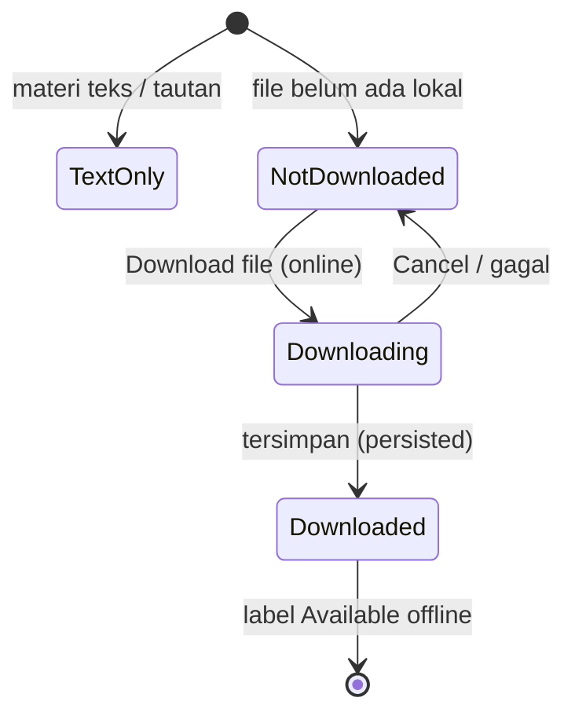
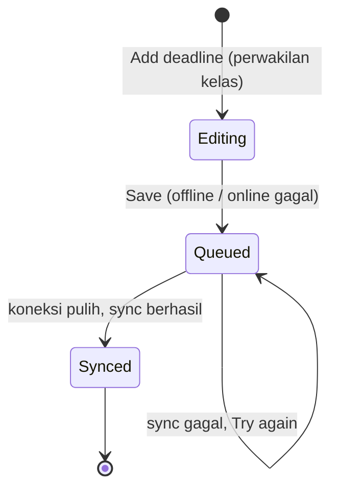

# LiteLearn — Design System & Implementation Guide

> Sumber: Figma `LiteLearn Design` (file key `hNrbr8VaIqVatLlQRbIvg7`), dibaca langsung dari halaman `01 Foundations`, `02 Components`, `03 Screens Light`, `05 Prototype` (flow atlas), dan `06 Handoff` (Draft v1).
> Semua nama orang, NIM, mata kuliah, materi, pengumuman, dan deadline adalah **data sampel fiktif**.
> Cakupan dan celah dijelaskan di bagian 14. Bagian bertanda **(usulan)** adalah rekomendasi implementasi, bukan isi Figma.

## Daftar Isi

1. Produk & prinsip
2. Design tokens
3. Ikonografi
4. Layout, grid & responsivitas
5. Anatomi app shell
6. Katalog komponen
7. Inventaris layar
8. Konten & microcopy
9. Perilaku offline & state machine
10. Aksesibilitas
11. Motion & performa
12. Alur utama (8 flow)
13. Panduan implementasi (React / Tailwind) **(usulan)**
14. Cakupan, celah & hal yang harus direkonsiliasi

---

## 1. Produk & Prinsip

LiteLearn adalah asisten belajar **offline-first** untuk mahasiswa asrama IT Del. Nama navigasi utama: **Home, Courses, Deadlines, Settings**.

| Prinsip | Konsekuensi |
|---|---|
| Warna dengan tujuan | Gading hangat + navy. Peran semantik konsisten di Light dan Dark. Emas hanya penanda akademik kecil, tidak pernah jadi permukaan dominan. |
| Suara akademik, ritme andal | Source Serif 4 untuk judul, Inter untuk UI. Ritme spasi 4 px. |
| Ruang terarah | Area kerja selalu dipusatkan di viewport dengan lebar maksimum yang jelas. Teks tetap rata kiri; alignment terpusat dipakai untuk shell auth dan state kosong saja. |
| Hierarki sebelum dekorasi | Satu aksen utama per section, heading konsisten, dan kartu hanya dipakai untuk mengelompokkan tugas yang berbeda. Hindari ornamen yang tidak membawa informasi. |
| Offline-first | Data mata kuliah dan catatan pribadi disimpan lokal. Edit perwakilan kelas di-queue saat offline. |
| Jujur soal status | Jangan melabeli file yang belum ada sebagai "Available offline". Konfirmasi unduhan hanya setelah persistensi. Edit lokal tidak boleh diklaim sudah sinkron. |
| Vector-only | Tanpa gambar di app shell. Ikon hanya SVG. |
| Aksesibel | Teks 16 px, target sentuh 44 px, fokus 2 px primary, status selalu ikon + teks. |

Autentikasi memakai **NIM + password, bukan email**. Registrasi wajib online.

---

## 2. Design Tokens

Aturan penamaan: variabel Figma `a/b-c` → CSS `--a-b-c` (semua `/` diganti `-`, tambah awalan `--`). Nilai numerik dalam **px**. Koleksi bermode tunggal bernilai sama di Light dan Dark. Total 89 variabel di 6 koleksi (Color, Course Accent, Space, Radius, Typography, Dimensions) sudah terpetakan; tidak ada koleksi duplikat.

### 2.1 Warna

| Token | Light | Dark | Peran |
|---|---|---|---|
| `--color-bg` | `#F7F5F0` | `#0E1626` | Latar halaman |
| `--color-surface` | `#FFFFFF` | `#16233B` | Kartu, panel |
| `--color-surface-2` | `#EFEBE3` | `#1D2C48` | Permukaan sekunder |
| `--color-border` | `#E3DED3` | `#2A3A57` | Garis dekoratif |
| `--color-text` | `#14213D` | `#EAEFF8` | Teks utama |
| `--color-text-muted` | `#5B6478` | `#9AA7BF` | Teks sekunder |
| `--color-primary` | `#1E3A8A` | `#7DA2FF` | Aksi utama, fokus |
| `--color-primary-contrast` | `#FFFFFF` | `#0E1626` | Teks di atas primary |
| `--color-accent` | `#875E16` | `#E0B352` | Highlight emas kecil |
| `--color-success` | `#1C7449` | `#4CC38A` | Sukses, offline-ready |
| `--color-warning` | `#926016` | `#E0A94A` | Peringatan, due soon |
| `--color-danger` | `#B42318` | `#F97066` | Error, overdue |
| `--color-shadow-1` | `rgba(20,33,61,0.08)` | `rgba(20,33,61,0)` | Shadow ringan |
| `--color-shadow-2` | `rgba(20,33,61,0.14)` | `rgba(20,33,61,0.14)` | Shadow overlay |

Catatan: di Light, accent `#875E16`, success `#1C7449`, warning `#926016` adalah versi yang digelapkan dari saran awal agar lolos AA. `border` bersifat dekoratif; bukan indikator fokus.

### 2.2 Course Accent

Warna mengidentifikasi **mata kuliah, bukan urgensi**. Selalu sandingkan dengan kode dan nama mata kuliah.

| Token | Nama | Light | Dark |
|---|---|---|---|
| `--course-1` | Navy | `#1E3A8A` | `#7DA2FF` |
| `--course-2` | Teal | `#0F766E` | `#5BD4C5` |
| `--course-3` | Violet | `#7C3AED` | `#B79AFF` |
| `--course-4` | Amber | `#B45309` | `#F4B76A` |
| `--course-5` | Rose | `#BE185D` | `#F593C2` |
| `--course-6` | Slate | `#475569` | `#A8B8CE` |

### 2.3 Space, Radius, Shadow

| Space | px | | Radius | px | | Shadow | Geometri |
|---|---|---|---|---|---|---|---|
| `--space-1` | 4 | | `--radius-sm` | 8 | | `--shadow-1` | y 1, blur 3, navy 8% (transparan di Dark) |
| `--space-2` | 8 | | `--radius-md` | 12 | | `--shadow-2` | y 8, blur 24, navy 14% |
| `--space-3` | 12 | | `--radius-lg` | 16 | | | |
| `--space-4` | 16 | | `--radius-full` | 999 | | | |
| `--space-6` | 24 | | | | | | |
| `--space-8` | 32 | | | | | | |
| `--space-12` | 48 | | | | | | |

### 2.4 Tipografi

| Style | Family / weight | Size / LH (px) | Token |
|---|---|---|---|
| Display | Source Serif 4 SemiBold | 28 / 34 | `--type-display-size`, `--type-display-line-height` |
| H1 | Source Serif 4 SemiBold | 24 / 30 | `--type-h1-*` |
| H2 | Source Serif 4 SemiBold | 20 / 26 | `--type-h2-*` |
| H3 | Inter SemiBold | 17 / 24 | `--type-h3-*` |
| Body | Inter Regular | 16 / 24 | `--type-body-*` |
| Body Strong | Inter SemiBold | 16 / 24 | `--type-body-strong-*` |
| Small | Inter Regular | 14 / 20 | `--type-small-*` |
| Small Strong | Inter SemiBold | 14 / 20 | `--type-small-strong-*` |
| Caption | Inter Medium | 12 / 16 | `--type-caption-*` |
| Button | Inter SemiBold | 16 / 24 | `--type-button-*` |

Tidak ada style tipografi terpisah untuk Dark. Body default 16/24. Batasi panjang baris ±80 karakter. Spesimen Foundations: "Make room for focused study."

### 2.5 Dimensions (px)

`0, 1, 1.75, 2, 3, 4, 8, 10, 12, 16, 20, 24, 28, 32, 36, 40, 44, 48, 52, 56, 64, 90, 104, 128, 190, 192, 220, 240, 250, 280, 296, 328, 360, 520, 600, 800, 999, 1480`
Token: `--dimension-<n>` (`1.75` → `--dimension-1-75`).

### 2.6 Kerangka CSS

```css
:root {
  --color-bg: #F7F5F0;           --color-surface: #FFFFFF;
  --color-surface-2: #EFEBE3;    --color-border: #E3DED3;
  --color-text: #14213D;         --color-text-muted: #5B6478;
  --color-primary: #1E3A8A;      --color-primary-contrast: #FFFFFF;
  --color-accent: #875E16;       --color-success: #1C7449;
  --color-warning: #926016;      --color-danger: #B42318;
  --color-shadow-1: rgba(20, 33, 61, 0.08);
  --color-shadow-2: rgba(20, 33, 61, 0.14);

  --course-1: #1E3A8A; --course-2: #0F766E; --course-3: #7C3AED;
  --course-4: #B45309; --course-5: #BE185D; --course-6: #475569;

  --space-1: 4px;  --space-2: 8px;  --space-3: 12px; --space-4: 16px;
  --space-6: 24px; --space-8: 32px; --space-12: 48px;
  --radius-sm: 8px; --radius-md: 12px; --radius-lg: 16px; --radius-full: 999px;

  --shadow-1: 0 1px 3px 0 var(--color-shadow-1);
  --shadow-2: 0 8px 24px 0 var(--color-shadow-2);

  --type-display-size: 28px; --type-display-line-height: 34px;
  --type-h1-size: 24px;      --type-h1-line-height: 30px;
  --type-h2-size: 20px;      --type-h2-line-height: 26px;
  --type-h3-size: 17px;      --type-h3-line-height: 24px;
  --type-body-size: 16px;    --type-body-line-height: 24px;
  --type-small-size: 14px;   --type-small-line-height: 20px;
  --type-caption-size: 12px; --type-caption-line-height: 16px;
  --type-button-size: 16px;  --type-button-line-height: 24px;
}

[data-theme="dark"] {
  --color-bg: #0E1626;           --color-surface: #16233B;
  --color-surface-2: #1D2C48;    --color-border: #2A3A57;
  --color-text: #EAEFF8;         --color-text-muted: #9AA7BF;
  --color-primary: #7DA2FF;      --color-primary-contrast: #0E1626;
  --color-accent: #E0B352;       --color-success: #4CC38A;
  --color-warning: #E0A94A;      --color-danger: #F97066;
  --color-shadow-1: rgba(20, 33, 61, 0);
  --color-shadow-2: rgba(20, 33, 61, 0.14);

  --course-1: #7DA2FF; --course-2: #5BD4C5; --course-3: #B79AFF;
  --course-4: #F4B76A; --course-5: #F593C2; --course-6: #A8B8CE;
}
```

Catatan: `[data-theme]` adalah mekanisme **(usulan)**. Token `body-strong` dan `small-strong` mengikuti pola yang sama; bobot huruf ditetapkan di kelas teks, bukan di variabel.

---

## 3. Ikonografi

Grid 24 × 24, stroke bulat **1.75 px** (`--dimension-1-75`), komponen native dengan ekspor SVG. Ukuran pakai di layar: 16 (status bar, chevron di baris materi), 20 (inline, banner, deadline), 24 (nav, wordmark), 32 (empty state).

| Baris | Ikon (nama komponen `Icon / <nama>`) |
|---|---|
| 1 | `home` `book` `calendar-check` `settings` `wifi` `wifi-off` |
| 2 | `signal-low` `check-circle` `cloud-download` `cloud-check` `refresh` `clock` |
| 3 | `alert-circle` `chevron-right` `chevron-down` `arrow-left` `plus` `note` |
| 4 | `link` `eye` `eye-off` `logout` `moon` `sun` |

Pemakaian semantik yang terlihat di layar:

| Ikon | Makna |
|---|---|
| `alert-circle` | Overdue, error, "Something went wrong" |
| `calendar-check` | Deadline normal / due soon, tab Deadlines |
| `check-circle` | Sukses, "Nothing due soon", Follow on |
| `cloud-download` | File belum diunduh |
| `refresh` | Downloading, loading, sync |
| `cloud-check` | File tersimpan offline, "Saved on this device" |
| `wifi` / `signal-low` / `wifi-off` | NetworkStatus online / slow / offline |
| `link` / `note` | Materi tautan eksternal / materi teks atau PDF |
| `eye` / `eye-off` | Visibilitas password |
| `moon` / `sun` | Tema Dark / Light |
| `book` | Courses, wordmark, empty state mata kuliah |
| `plus` | Tambah konten kelas (perwakilan kelas), Follow |

---

## 4. Layout, Grid & Responsivitas

| Rentang | Layout | Aturan |
|---|---|---|
| Mobile 360–767 | Draft 360 × 800 | 4 kolom; margin dan gutter 16; `BottomNav` 64; konten scroll di atas nav dan home indicator |
| Tablet 768–1023 | **Ditunda** | Tidak ada layout |
| Laptop 1024+ | Draft 1280 × 800 | `SideNav` 240; main max 960, margin 32; 12 kolom, gutter 24 |

Transformasi mobile → laptop:

| Mobile | Laptop |
|---|---|
| `BottomNav` | `SideNav` (240) |
| `BottomSheet` | `Modal` (max 520) |
| Satu kolom | Dua kolom |
| Auth penuh lebar | Kartu auth max 420, tanpa sidebar, terpusat |
| Settings | max 640 |
| Home | Kiri: next deadline + upcoming. Kanan: courses + announcements |
| Course Detail | Master-detail: daftar minggu / pratinjau materi |
| Material Detail | Catatan di samping file |
| Courses | Grid 2 kolom (kartu 476 px, gap 24) |

Ukuran terukur dari frame:

- Mobile: margin 16 → lebar konten **328**. Kartu berisi punya border 1 px sehingga isi dimulai di x = 17.
- Laptop Home: workspace 1040 → kolom kiri **616**, gap 24, kolom kanan **336** (total 976).
- Auth: kartu mobile 328; kartu laptop 420 dengan padding 24 (isi 372).

---

## 5. Anatomi App Shell

### Mobile (360 × 800)

| Lapisan | y | Tinggi | Catatan |
|---|---|---|---|
| Safe status bar | 0 | 24 | Jam "9:41", ikon wifi 16, baterai 22×10 |
| App bar | 24 | 88 | Judul halaman 24/30 serif + `NetworkStatus` di bawahnya. Varian detail: tombol back 44×44 kiri, judul, tombol aksi 44×44 kanan |
| Content viewport | 112 | 604 | Area scroll, margin 16 |
| `BottomNav` | 716 | 64 | Tab: Home, Courses, Deadlines, Settings |
| Safe home indicator | 780 | 20 | Batang 124×4 di tengah |

### Laptop (1280 × 800)

| Lapisan | Posisi | Ukuran |
|---|---|---|
| `SideNav` | x 0 | 240 × 800 |
| Study workspace | x 240 | 1040 × 800 |
| App bar | dalam workspace | 1040 × 104, heading di x 32 |
| Content viewport | y 104 | 1040 × 696, konten di x 32 |

### Pola section

- **Section heading**: teks serif H2 (26 px tinggi), tautan "See all" kecil di kanan bila ada.
- **Kartu**: radius 12, padding 16, border 1 px, gap 12.
- **Rule** dekoratif: garis 4 px di kartu hero, 3 px × 32 sebagai penanda aksen mata kuliah, 1 px sebagai pemisah daftar.
- **Alignment**: main content berada di tengah area kerja; halaman data memakai max-width 976 px, halaman form 420 px, settings 640 px. Isi kartu dan heading tetap rata kiri.
- **Footer status sinkron** di akhir halaman: "Last updated 20:41 · 2 changes waiting to sync." (Caption).

---

## 6. Katalog Komponen

Total 146 varian native di 21 keluarga + 24 ikon. Dimensi adalah ukuran representatif, **bukan lebar CSS tetap**; pertahankan perilaku fill/hug dan validasi text containment. Padding = atas/kanan/bawah/kiri.

| Komponen (React) | Node | Props / varian | Layout |
|---|---|---|---|
| `Button` | `3:12271` | Type: primary, secondary, ghost, danger. Size: M (44), L (52). State: default, pressed, disabled, loading, hover, focus. `Icon left`: bool. `Label`: text | Horizontal, pad 12, gap 8, radius 8. 48 varian (4 × 2 × 6) |
| `Input` | `3:12305` | Label, Helper text, Error text, Show helper. State: default, focus, filled, error, disabled | Vertikal, gap 8. Field 328×52, pad 12, gap 8, radius 8. Error 328×108 |
| `PasswordInput` | `3:12388` | Seperti Input + Visibility: hidden, shown | Seperti Input |
| `Card` | `3:12409` | State: default, pressed, hover, focus | Vertikal, pad 16, gap 12, radius 12 |
| `Chip` | `3:12473` | Type: neutral, success, warning, danger, info. Size: S, M. Icon: bool | Horizontal, gap 8, radius 999. S pad-v 4 (tinggi 32), M pad-v 8 (tinggi 40) |
| `NetworkStatus` | `3:12494` | online, slow, offline | Horizontal, gap 8, tinggi 24 (74 / 142 / 76 px lebar) |
| `AppBar` | `3:12515` | with title, with back button | Horizontal, pad 16, gap 12, 360×64 |
| `BottomNav` | `3:12594` | Active: Home, Courses, Deadlines, Settings | Horizontal, 360×64 |
| `SideNav` | `3:12714` | Active × State (default, hover, focus) = 12 varian | Vertikal, pad 24, gap 12, 240×800 |
| `CourseCard` | `3:12881` | Name, Code, Offline-ready (bool), Accent 1–6, Followed true/false | Vertikal, pad 16, gap 12, radius 12. 134 tinggi (followed), lebih pendek bila belum diikuti |
| `DeadlineItem` | `3:12909` | Title, Course, Due text. Urgency: overdue, due soon, normal | Horizontal, gap 12, 328×68 |
| `WeekSection` | `3:12973` | Title. State: collapsed, expanded. This week: true/false | Vertikal, pad 16, gap 12, radius 12. Collapsed 78, expanded 218 |
| `MaterialRow` | `3:13006` | Title, Size. State: text only, file not downloaded, file downloaded, downloading | Horizontal, gap 12, 328×48 |
| `AnnouncementItem` | `3:13012` | Course and posted time, Text | Vertikal, pad 16, gap 12, radius 12, 328×86 |
| `EmptyState` | `3:13022` | Title, Message, Action | Vertikal, pad 24, gap 16, 328×214 |
| `Skeleton` | `3:13040` | Shape: line (16), card (156), row (84) | Vertikal, gap 12 |
| `Toast` | `3:13059` | Type: info, success, error | Horizontal, pad 16, gap 12, radius 12, 328×58 |
| `BottomSheet` | `3:13090` | Variant: Bottom Sheet (360×346), Modal (520×326) | Vertikal, pad **24**, gap 16, radius 16 |
| `Modal` | `3:13089` | Varian Modal dari BottomSheet, max 520 | Sama |
| `SegmentedControl` | `3:13119` | Active: Weeks, Deadlines, Announcements | Horizontal, pad 4, gap 4, radius 8. Segmen 104×36 |
| `Toggle` | `3:13135` | on, off, disabled | Track 44×28, pad 4, radius 999. Hit area 44×44 |
| `ListRow` | `3:13153` | Variant: with chevron, with toggle, with value. State: default, hover, focus (9 varian) | Horizontal, gap 12, 328×52 |

Aturan hit area dan fokus:

- Mobile target minimal **44 px**; laptop minimal **36 px**.
- `Chip` dan `NetworkStatus` ringkas bukan target sentuh 44 px; jika interaktif, bungkus dengan hit area ≥ 44 px.
- Fokus: ring **2 px primary**.
- Gunakan layout native terukur; jangan menebak ukuran.

### Turunan perilaku komponen

- **Button**: M = 44 px, L = 52 px. Loading menampilkan ikon `refresh` + "Please wait...". Danger dipakai untuk "Sign out and clear data".
- **Input**: label di atas, field di bawah. Error menambah teks bantu (tinggi 108). Field `disabled` dipakai saat Sign In loading.
- **Chip**: tipe `success` dipakai untuk "Available offline" (ikon + teks), `danger` untuk overdue, `warning` untuk due soon, `neutral`/`info` untuk lainnya.
- **WeekSection**: minggu berjalan menampilkan chip "This week" dan terbuka secara default (Week 6 dari 14).
- **MaterialRow**: tiap state punya ikon berbeda (lihat bagian 3) dan sub-baris metadata ("PDF · 1.2 MB · Available offline").

---

## 7. Inventaris Layar

Total desain: 224 frame = 56 state × 2 device × 2 tema (112 Light di halaman `03 Screens Light`, 112 Dark di `04 Screens Dark`). Nama frame: `Screen / <Layar> / <State> / <Mobile|Laptop>`.

### 7.1 Layar yang sudah dibaca (node ID)

| Layar | State | Mobile | Laptop |
|---|---|---|---|
| **Sign In** | Default | `3:14620` | `3:14652` |
| | Error | `3:14676` | `3:14712` |
| | Loading | `3:14741` | `3:14774` |
| **Sign Up** | Default | `3:14800` | `3:14845` |
| | Error | `3:14883` | tidak dibaca |
| **Home** | Default | `3:13158` | `3:13258` |
| | Loading | `3:13365` | `3:13411` |
| | Offline | `3:13461` | `3:13566` |
| | Empty | `3:13678` | `3:13721` |
| | Nothing due | `3:13768` | `3:13835` |
| | Error | `3:13909` | `3:13952` |
| **Courses** | Default | `3:13999` | `3:14079` |
| | Loading | `3:14165` | `3:14211` |
| | Empty | `3:14261` | `3:14304` |
| | Offline | `3:14351` | `3:14436` |
| | Error | `3:14527` | `3:14570` |
| **Course Detail** | Weeks | `3:16153` | — |
| | Deadlines | `3:16490` | — |
| | Offline | `3:16948` | — |
| **Material Detail** | File not downloaded | `3:17506` | — |
| | Downloading | `3:17635` | — |
| | File downloaded | `3:17770` | — |
| **Deadlines** | Default | `3:15071` | — |
| **Settings** | Default (Light) | `3:15611` | — |
| | Dark | `3:23536` | — |
| **Add deadline** | Offline (sheet) | `3:19710` | Modal (tidak dibaca) |

### 7.1b Layar Dark (halaman `04 Screens Dark`, node `3:5`)

Struktur layer, ukuran, dan teks **identik** dengan versi Light (diverifikasi pada Home, Courses, Sign In, Sign Up). Perbedaannya hanya mode warna semantik: variabel di-resolve ke kolom Dark pada bagian 2. Tidak ada komponen atau tata letak khusus Dark. Di Dark, `--shadow-1` transparan, jadi pemisahan permukaan mengandalkan `--color-surface` vs `--color-bg` dan `--color-border`.

| Layar | State | Mobile | Laptop |
|---|---|---|---|
| **Sign In** | Default | `3:22869` | `3:22897` |
| | Error | `3:22919` | `3:22951` |
| | Loading | `3:22977` | `3:23006` |
| **Sign Up** | Default | `3:23029` | `3:23070` |
| | Error | `3:23105` | tidak dibaca |
| **Home** | Default | `3:22129` | `3:22196` |
| | Loading | `3:22261` | `3:22279` |
| | Offline | `3:22292` | `3:22363` |
| | Empty | `3:22432` | `3:22452` |
| | Nothing due | `3:22467` | `3:22508` |
| | Error | `3:22547` | `3:22567` |
| **Courses** | Default | `3:22582` | `3:22628` |
| | Loading | `3:22671` | `3:22689` |
| | Empty | `3:22702` | `3:22722` |
| | Offline | `3:22737` | `3:22787` |
| | Error | `3:22834` | `3:22854` |
| **Settings** | Default (Dark) | `3:23536` | — |

Layar Dark lain (Course Detail, Material Detail, Deadlines, Add deadline) berada di halaman yang sama setelah Sign Up, tetapi ID-nya belum dibaca.

### 7.2 Isi per layar

**Sign In** — viewport otentikasi berisi kartu: wordmark (ikon `book` + "LiteLearn"), tagline "Your courses, even without signal.", judul "Welcome back", field NIM dan Password (dengan ikon `eye-off`), tombol "Sign in", tautan "New here? Create an account". Error: banner `alert-circle` "NIM or password is incorrect." di atas form, kedua field berstatus error. Loading: field disabled, tombol berisi ikon `refresh` + "Please wait...".

**Sign Up** — judul "Create your account"; field NIM, Display name, Password, Confirm password, Class code; tombol "Create account"; tautan "Already registered? Sign in". Konten lebih tinggi dari viewport, jadi form scroll.

**Home** — heading "Good evening, Aisha" + `NetworkStatus`. Urutan: *Next deadline* (kartu hero: rule 4 px, kode mata kuliah, chip urgensi, judul serif, nama mata kuliah, waktu jatuh tempo, tombol "View deadline") → *Upcoming* (daftar `DeadlineItem` dengan pemisah, "See all") → *Your courses* (kartu mata kuliah dengan toggle "Following" dan chip offline) → *Latest announcements* → footer sinkron.
State khusus: Loading = 4 `Skeleton`. Offline = banner `wifi-off` "You're offline. Showing saved content." di atas konten. Empty = `EmptyState` "Your courses start here" + tombol "Browse courses". Nothing due = kartu `check-circle` "Nothing due soon." + "A little breathing room. Your next deadlines will appear here." dan "You're all caught up." Error = `EmptyState` `alert-circle` "Something went wrong" + tombol "Try again".

**Courses** — intro "Follow your courses. Keep learning offline." Daftar kartu mata kuliah (COURSE-101 sampai 104). Mata kuliah yang diikuti berlabel "Following" + chip offline; yang belum, berlabel "Follow". Empty: "No courses available" / "Your class courses will appear here when they are ready." Error dan Loading mengikuti pola Home.

**Course Detail** — app bar: back, judul "Course detail", tombol `plus` (tambah konten kelas, untuk perwakilan kelas). Heading "COURSE-101 · WEEK 6 OF 14" + nama + chip. `SegmentedControl` Weeks / Deadlines / Announcements. 14 `WeekSection`; Week 6 terbuka dengan chip "This week", berisi baris materi (file downloaded, tautan eksternal, teks), satu deadline, satu pengumuman.

**Material Detail** — heading "COURSE-101 · WEEK 6", judul materi, blok "About this material" (+ tombol "Open practice set 3"), blok file, dan **Private notes** ("Saved on this device", "Only visible to you on this device."). Blok file per state:
- *Not downloaded*: nama file, "PDF · 1.2 MB", tombol "Download file".
- *Downloading*: progress bar 4 px, "Downloading · 64% of 1.2 MB", tombol "Cancel download".
- *Downloaded*: ikon `cloud-check` + label "Available offline".

**Deadlines** — intro "All your followed courses, in one place." Grup: Overdue, Today ("Nothing due today."), This week, Later ("No later deadlines yet."). Item memakai ikon + teks urgensi.

**Settings** — Appearance: `SegmentedControl` tema System / Light / Dark. Data & storage: toggle "Data saver" ("On · Download files only when you choose."), tombol "Sync now", status sinkron. Account (read-only): Display name, NIM, tombol danger "Sign out and clear data". Footer "LiteLearn · Version 1.0.0". Batas lebar Settings di laptop: 640.

**Add deadline (perwakilan kelas)** — sheet di atas Course Detail dengan scrim. Heading "Add deadline", kicker "CLASS REPRESENTATIVE · COURSE-101". Field: Week, Title, Due date, Time. Aksi: Cancel / Save. Setelah simpan offline: banner sukses "Saved on this device. Will sync later." Di laptop tampil sebagai `Modal`.

---

## 8. Konten & Microcopy

Data sampel konsisten (jaga identitas dan tanggal tetap sama di semua layar).

| Entitas | Nilai sampel |
|---|---|
| Pengguna | Aisha Putri, NIM `11425018` |
| Mata kuliah | `COURSE-101` Introduction to Programming; `COURSE-102` Calculus; `COURSE-103` Physics Basics; `COURSE-104` Academic Writing |
| Deadline | Assignment 2: Loops (COURSE-101, "Tomorrow, 23:59"); Quiz 3 (COURSE-102, "Friday, 10:00"); Lab report (COURSE-103, "Overdue 1 day") |
| Materi | Slides: Variables and Types (PDF · 1.2 MB, `Variables-and-Types.pdf`); Practice set 3 (tautan eksternal); Lecture summary (teks) |
| Pengumuman | "COURSE-101 · 2 hours ago — Class moves to Room B on Thursday." |
| Sinkron | "Last updated 20:41 · 2 changes waiting to sync." |

Microcopy kunci (jangan diubah tanpa alasan, banyak yang membawa makna kejujuran status):

| Konteks | Teks |
|---|---|
| Offline banner | You're offline. Showing saved content. |
| Edit lokal | Saved on this device. Will sync later. |
| Gagal sync | Try again (data antrean tetap tersimpan) |
| Error muat | Something went wrong / We couldn't load this content. Your saved work is safe. |
| Login gagal | NIM or password is incorrect. |
| Progres unduh | Downloading · 64% of 1.2 MB |
| Tersimpan offline | Available offline (hanya setelah persistensi) |
| Catatan privat | Only visible to you on this device. |

---

## 9. Perilaku Offline & State Machine

- Simpan data mata kuliah dan catatan pribadi secara lokal.
- Edit perwakilan kelas saat offline di-queue; tampilkan "Saved on this device. Will sync later."
- Jika sinkronisasi gagal, pertahankan pekerjaan dalam antrean dan tawarkan **Try again**.
- Jangan pernah melabeli file yang hilang sebagai "Available offline".
- Tampilkan progres unduhan; konfirmasi hanya setelah data tersimpan.
- Registrasi butuh koneksi. Sign-in memakai NIM + password.
- Status "Follow" dan kesiapan offline adalah **dua pesan terpisah dan eksplisit**.
- Unduhan file butuh koneksi; saat offline tombol "Download file" tidak boleh menjanjikan hasil.





Hubungan state dengan UI: `NetworkStatus` (online / slow / offline) selalu tampil di app bar; banner offline muncul di bawah app bar saat offline; footer sinkron selalu menyebut jumlah perubahan menunggu.

---

## 10. Aksesibilitas

Audit 44 pasangan token (WCAG sRGB; linearisasi pada 0.04045; rasio dibulatkan 2 desimal, lulus/gagal pada nilai tak dibulatkan). Teks normal AA ≥ 4.5:1; teks besar dan grafis bermakna ≥ 3:1. **44 / 44 lulus AA teks normal.**

| Mode / foreground | di bg | di surface | di surface-2 |
|---|---|---|---|
| Light / text | 14.66 | 15.97 | 13.44 |
| Light / text-muted | 5.45 | 5.93 | 4.99 |
| Light / primary | 9.51 | 10.36 | 8.71 |
| Light / accent | 5.29 | 5.76 | 4.85 |
| Light / success | 5.29 | 5.76 | 4.85 |
| Light / warning | 4.93 | 5.38 | 4.52 |
| Light / danger | 6.03 | 6.57 | 5.53 |
| Dark / text | 15.67 | 13.61 | 12.08 |
| Dark / text-muted | 7.45 | 6.47 | 5.75 |
| Dark / primary | 7.30 | 6.34 | 5.63 |
| Dark / accent | 9.25 | 8.03 | 7.13 |
| Dark / success | 8.16 | 7.09 | 6.29 |
| Dark / warning | 8.56 | 7.43 | 6.60 |
| Dark / danger | 6.49 | 5.63 | 5.00 |

`primary-contrast` di atas `primary`: Light 10.36:1, Dark 7.30:1.

Aturan:

- Status dan urgensi **selalu ikon + teks**; warna saja tidak cukup.
- Body 16 px; target sentuh minimum 44 px; fokus 2 px primary.
- Garis `border` dekoratif, bukan indikator fokus.
- Emas tetap highlight kecil.

Ini audit pasangan token, **bukan sertifikasi aksesibilitas 224 layar**. Yang masih harus divalidasi saat implementasi: urutan keyboard, nama aksesibel, pesan error, reduced motion, screen reader, text clipping dan containment.

---

## 11. Motion & Performa

- Reduced motion menghapus **semua** animasi.
- Panduan prototype terhubung nanti: ease-out 150–250 ms. Ini permintaan, **belum ada** di Figma (tanpa reaction, trigger, transisi).

| Budget (kontrak, belum terukur) | Batas |
|---|---|
| CSS awal | < 30 KB gzip |
| Font total | < 60 KB, self-hosted, subset Latin |
| Gambar di app shell | Tidak ada, vector-only |
| Ekspor | Hanya ikon SVG; tanpa PNG/JPEG shell |

Ukur Source Serif 4 SemiBold dan Inter bersamaan sebelum rilis.

---

## 12. Alur Utama (8 flow)

Referensi statis; koneksi prototype harus dibuat manual. Atlas: node `3:31485`.

| # | Flow | Layar (node) |
|---|---|---|
| 1 | Create account → Home | Sign Up `3:14800` → Home `3:13158` |
| 2 | Sign in → Home | Sign In `3:14620` → Home `3:13158` |
| 3 | Offline Home → Course → Material | Home Offline `3:13461` → Course Detail Offline `3:16948` → Material Downloaded `3:17770` |
| 4 | Missing → Downloading → Downloaded | `3:17506` → `3:17635` → `3:17770` |
| 5 | Follow off → Follow on + badge | CourseCard `3:12745` → `3:12733` |
| 6a | Home hero → Course deadlines | Home `3:13158` → Course Detail Deadlines `3:16490` |
| 6b | Navigasi → Deadlines | BottomNav `3:12536` → Deadlines `3:15071` |
| 7 | Course plus → Add deadline offline → Save → toast lokal | `3:16153` → `3:19710` → Toast success `3:13052` |
| 8 | Settings Theme → Dark | Settings `3:15611` → `3:23536` |

Catatan: hero Home membawa konteks mata kuliah ke Deadlines tingkat mata kuliah; tab Deadlines membuka daftar semua mata kuliah yang diikuti. Keduanya tujuan berbeda.

---

## 13. Panduan Implementasi (React / Tailwind) **(usulan)**

### 13.1 Prinsip

- Reuse komponen dan token yang ada; jangan hardcode warna atau ukuran. Semua nilai lewat `var(--…)`.
- Pertahankan state komponen sebagai prop eksplisit, bukan kelas ad hoc.
- State dengan makna jujur (offline, downloaded, queued) dimodelkan sebagai **union type**, bukan boolean.
- Pakai tema lewat atribut `data-theme` di `<html>`; opsi `System` mengikuti `prefers-color-scheme`.

### 13.2 Struktur folder

```
presentation/
  styles/tokens.css        # sumber token (rekonsiliasi dengan bagian 2)
  components/              # Button, Input, Card, Chip, ...
  layouts/                 # AppShell (mobile/laptop), AuthLayout
  screens/                 # Home, Courses, CourseDetail, MaterialDetail, Deadlines, Settings, SignIn, SignUp
  icons/                   # 24 komponen SVG, stroke 1.75
```

### 13.3 Tipe props (turunan varian Figma)

```ts
type ButtonProps = {
  type: 'primary' | 'secondary' | 'ghost' | 'danger';
  size: 'M' | 'L';                 // M = 44 px, L = 52 px
  label: string;
  iconLeft?: boolean;
  loading?: boolean;               // state "loading"
  disabled?: boolean;
};

type ChipType = 'neutral' | 'success' | 'warning' | 'danger' | 'info';

type MaterialState =
  | { kind: 'text-only' }
  | { kind: 'file-not-downloaded'; sizeLabel: string }
  | { kind: 'downloading'; progress: number; sizeLabel: string }   // 0..1
  | { kind: 'file-downloaded'; sizeLabel: string };                // hanya setelah persisted

type Urgency = 'overdue' | 'due-soon' | 'normal';
type NetworkState = 'online' | 'slow' | 'offline';
type CourseAccent = 1 | 2 | 3 | 4 | 5 | 6;
type ThemePreference = 'system' | 'light' | 'dark';
type ActiveNav = 'home' | 'courses' | 'deadlines' | 'settings';

type SyncState =
  | { kind: 'synced'; lastUpdated: string }
  | { kind: 'queued'; pendingChanges: number; lastUpdated: string }
  | { kind: 'failed'; pendingChanges: number };                    // tampilkan "Try again"
```

### 13.4 Breakpoint

```ts
// Mobile 360–767, tablet 768–1023 (ditunda), laptop ≥ 1024
export const breakpoints = { laptop: 1024 } as const;
```

Di bawah 1024 pakai `BottomNav` + `BottomSheet`; di atas pakai `SideNav` + `Modal`. Tablet jangan didesain ulang sampai ada frame.

### 13.5 Checklist QA per layar

1. Cocokkan dengan frame Figma pada kedua tema dan kedua device.
2. Semua target sentuh ≥ 44 px (mobile) / 36 px (laptop).
3. Fokus keyboard terlihat (2 px primary) dan urutan wajar.
4. Tiap status memiliki ikon + teks.
5. Teks tidak terpotong pada konten panjang (nama mata kuliah, judul materi).
6. Reduced motion mematikan animasi.
7. Offline: banner, label, dan footer sinkron akurat; tidak ada klaim "Available offline" tanpa file lokal.

---

## 14. Cakupan, Celah & Hal yang Harus Direkonsiliasi

### Sudah dibaca langsung dari Figma

- Foundations (warna, course accent, tipografi, spasi, radius, shadow, 24 ikon, kontras).
- Daftar lengkap komponen beserta node ID dan varian.
- Layar Light: Home, Courses, Sign In (semua state), Sign Up (Default + Error mobile), Course Detail Weeks, Material Detail (not downloaded, downloading), Deadlines, Settings, Add deadline.
- Flow atlas dan halaman Handoff.

### Belum dibaca satu per satu

- Frame Dark: Home, Courses, Sign In, Sign Up, dan Settings sudah dipetakan (bagian 7.1b). Frame Dark untuk Course Detail, Material Detail, Deadlines, dan Add deadline belum dibaca. Tidak ada pemeriksaan visual.
- Layar laptop untuk Course Detail, Material Detail, Deadlines, Settings, Add deadline (Modal).
- State layar yang namanya belum terlihat dari 56 state (mis. sisa state Sign Up, Course Detail Deadlines/Offline, Deadlines/Settings variasi lain).
- Tidak ada screenshot visual; deskripsi layar berasal dari struktur layer dan teks.

### Hal yang perlu dicocokkan

| Item | Catatan |
|---|---|
| `presentation/styles/tokens.css` | Belum diperiksa terhadap token di dokumen ini (kewajiban rekonsiliasi dari Handoff). |
| Lebar konten laptop | Kontrak responsif menyebut main max **960**; frame Home laptop memakai konten **976** di workspace 1040 (margin 32). Tentukan mana yang berlaku. |
| BottomSheet padding | Aktual **24**, bukan saran awal 16. |
| Modal vs BottomSheet | Modal adalah varian BottomSheet (`3:13089` vs `3:13090`); jadikan satu komponen dengan prop varian atau dua komponen yang berbagi basis. |
| Hit area ringkas | Chip dan NetworkStatus tidak memenuhi 44 px sendiri. |
| Tablet | Ditunda. |
| Prototype | Belum terhubung; 8 flow harus di-wire manual. |
| Motion dan budget performa | Kontrak, bukan hasil ukur. |
| QA aksesibilitas | Implementasi kode detail dan QA aksesibilitas belum dikerjakan. |